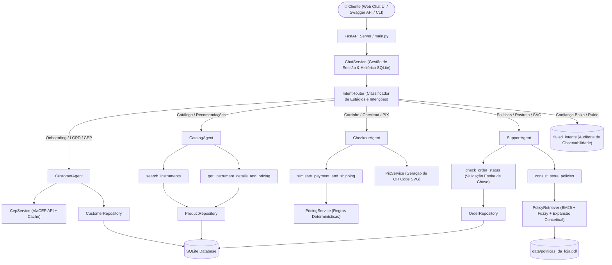

# 🎸 Empório da Música — AI Customer Support & Sales Agent


> **Assistente Conversacional de E-commerce com IA & Arquitetura Multiagente Especializada**  
> Desenvolvido para a **Empório da Música** (*"Sua música começa aqui"* — Campo Grande/MS), fundamentado em **Clean Architecture, SOLID, Function Calling Nativo, RAG Semântico Híbrido, Motor Financeiro Determinístico e Interface Conversacional Glassmorphism**.

---

## ⚡ Guia Rápido do Avaliador (Quick Start em 3 Minutos)

Se você é o avaliador técnico e deseja testar o sistema imediatamente, siga estes passos:

### 1. Clonar, Instalar e Iniciar o Servidor

```bash
# 1. Clone o repositório e acesse a pasta
git clone <URL_DO_REPOSITORIO>
cd emporio-da-musica-ai

# 2. Crie e ative o ambiente virtual
python -m venv .venv
# Windows (PowerShell):
.\.venv\Scripts\Activate.ps1
# Linux / macOS:
source .venv/bin/activate

# 3. Instale as dependências
pip install -r requirements.txt

# 4. Configure o .env com sua chave Groq (gratuita em console.groq.com)
cp .env.example .env
# Certifique-se de que GROQ_API_KEY=gsk_... está preenchida no arquivo .env

# 5. Inicie a aplicação no modo API (com Web Chat Glassmorphism)
python main.py --mode api --port 8000
```

Abra no seu navegador: **[`http://localhost:8000`](http://localhost:8000)**  
(Documentação interativa Swagger disponível em **[`http://localhost:8000/docs`](http://localhost:8000/docs)**)

---

### 2. Roteiro de Teste Interativo (Prompts Prontos para Copiar e Colar)

Para validar todos os critérios do desafio de ponta a ponta na Web UI, utilize os seguintes exemplos:

| Passo / Funcionalidade | O que digitar no chat | O que o sistema faz / validação esperada |
| :--- | :--- | :--- |
| **1. Identificação Segura (LGPD)** | `(67) 99812-3456` | Reconhece **Lucas Mendes da Silva**, dá as boas-vindas calorosas e sugere botões de ação rápida. |
| **2. Consulta de Catálogo com Filtro** | `quero ver violões até 1000 reais` | Aciona o `CatalogAgent`, busca no SQLite e exibe os cards 3D de violões disponíveis até R$ 1.000,00 com botão de adicionar ao carrinho. |
| **3. Busca Abrangente (sem truncamento)** | `quero ver produtos até 2000 reais` | Retorna **todos os 37 instrumentos** cadastrados até R$ 2.000,00 (de R$ 159,90 a R$ 1.967,18), sem truncamento prematuro de 15 itens. |
| **4. Tratamento de Item Indisponível** | `tem pandeiro?` | Informa cordialmente que a loja foca em instrumentos de cordas, teclas e sopros, **sem alucinar estoque nem poluir a tela com carrosséis aleatórios**. |
| **5. Card 3D e Amostra Sonora** | *Clique no botão 🎧 Amostra Sonora ou 📖 Descrição no card* | O card gira em 3D revelando o player de áudio com timbre do instrumento e modal com especificações detalhadas de madeira e acabamento. |
| **6. Adição ao Carrinho e Fechamento** | `adicionar 1 Giannini GF-1R ao carrinho` e depois `fechar meu pedido` | Transiciona para o `CheckoutAgent`. Mostra o resumo do carrinho e solicita confirmação do endereço cadastrado. |
| **7. Confirmação de Endereço** | `Sim, endereço correto` | Valida endereço e calcula frete determinístico (Grátis para Campo Grande acima de R$ 500; taxa fixa de R$ 35 abaixo de R$ 500). Apresenta as opções de pagamento. |
| **8. Simulação de Pagamento (PIX)** | `⚡ Pagar no PIX (5% off)` *(ou "no pix")* | Aplica 5% de desconto à vista, gera o payload PIX Copia-e-Cola e renderiza o **QR Code dinâmico em SVG**, apresentando a tela de conferência final. |
| **9. Confirmação do Pedido** | `Sim, confirmar pedido` | Registra o pedido com sucesso, confirma agendamento do motoboy próprio e **dispara a Pesquisa de Satisfação (CSAT) de 1 a 5**. |
| **10. Pesquisa de Satisfação (CSAT)** | `⭐ 5 (Excelente)` *(ou digite "5")* | Registra a nota, envia mensagem de agradecimento humanizada, conclui o atendimento e bloqueia o campo com botão `[ 🔄 Novo Atendimento ]`. |
| **11. Direito de Arrependimento e Devolução** | `Me arrependi da minha compra, posso devolver meu pedido?` | Identifica a intenção de pós-venda (`SupportAgent`). Explica a **Seção 4.1 das Políticas da Loja e o CDC**: prazo de 7 dias, frete 100% gratuito pela loja, reembolso em até 10 dias úteis e identifica o Pedido #4 entregue. |
| **12. Rastreamento Determinístico** | `quero ver meus pedidos` | Consulta o banco relacional SQLite e exibe os dados do Pedido #4 com código de rastreamento `BRQM7890123BR`, previsão e status de entrega. |

---

## 📋 Sumário Executivo

A **Empório da Música** é uma loja tradicional de instrumentos musicais fundada em 2008 em Campo Grande/MS que buscava otimizar e escalar seu atendimento ao cliente sem perder a proximidade, o conhecimento musical e a segurança de dados.

Este projeto entrega uma solução pronta para produção que soluciona o desafio de ponta a ponta através de uma **Arquitetura Multiagente Especializada e Híbrida**:

1. **Arquitetura Multiagente Especialista (`IntentRouter`):** Roteamento determinístico e dinâmico que encaminha cada turno do cliente para agentes dedicados com escopo restrito de ferramentas e prompts especializados:
   - **`CustomerAgent`:** Onboarding seguro (LGPD), identificação unívoca por telefone/e-mail, termos de aceite e integração com **ViaCEP** para preenchimento e validação automática de endereço.
   - **`CatalogAgent`:** Busca e recomendação de instrumentos musicais com zero alucinação, filtros de estoque/preço e renderização de cards interativos 3D.
   - **`CheckoutAgent`:** Fechamento de carrinho, validação direta de endereço cadastrado, cálculo determinístico de parcelas sem juros (respeitando as regras de parcela mínima da política da loja) e descontos de 5% no PIX, verificação de frete (motoboy em Campo Grande ou transportadora regional), etapa intermediária de conferência do pedido e simulação de pagamento segura (sem solicitação de dados confidenciais de cartão).
   - **`SupportAgent`:** Políticas de troca/devolução (CDC), consulta de status e rastreamento de pedidos com validação estrita de titularidade e dúvidas institucionais.
2. **Zero Alucinação Numérica e Regras de Negócio:** Consultas estruturadas em banco relacional **SQLite** (alimentado por pipeline ETL idempotente dos CSVs operacionais) acopladas ao `PricingService` para garantir conformidade matemática estrita (bloqueio de desconto duplo de PIX em promoções ativas, limites de parcelamento e regras de frete).
3. **RAG Semântico Híbrido para Políticas da Loja (`políticas_da_loja.pdf`):** Extração hierárquica do PDF de políticas da loja, normalização de layouts e motor de busca combinando **BM25 + Expansão de Conceitos Multilíngues (PT/EN/ES) + Similaridade Fuzzy (`rapidfuzz`)**.
4. **Resiliência de LLM (Multi-Model Fallback Chain):** Inferência de ultra-baixa latência via **Groq API** com **Qwen (`qwen/qwen3.8-27b`) como primário**, garantindo raciocínio ágil em português brasileiro, com *fallback* automático em cascata (`openai/gpt-oss-120b` $\rightarrow$ `openai/gpt-oss-20b`) contra oscilações de conexão ou *rate limits*.
5. **Experiência Conversacional de Alto Padrão (Glassmorphism Web UI):**
   - Cards 3D interativos com rotação frente/verso (*flip card*) exibindo especificações de madeira, tampo e acabamento.
   - Player de áudio com simulação de timbre real do instrumento.
   - Seletores de quantidade (`-` / `+`) e adição direta ao carrinho no chat.
   - Formulários modais e inline integrados com consulta instantânea de CEP.
   - Comunicação humanizada: sem jargões técnicos de frontend (substituindo termos como "carrossel" por *"confira abaixo a lista de opções disponíveis..."*).
   - Fluxo de checkout em duas etapas: seleção do método/parcelas $\rightarrow$ tela de conferência final com botões de confirmação (`Sim, confirmar pedido` / `Não, alterar pagamento`).
   - Pesquisa de Satisfação (CSAT) pós-pedido de 1 a 5 com encerramento formal do chat.

---

## 🏗️ Arquitetura do Sistema



---

### 📂 Estrutura de Diretórios (Clean Architecture & Modularidade)

```text
📦 emporio-da-musica-ai
 ┣ 📂 data/                          # Dados operacionais (6 CSVs originais + PDF de Políticas)
 ┣ 📂 docs/
 ┃ ┣ 📂 examples/                    # 5 Transcrições reais multi-turno (.md)
 ┃ ┗ 📜 generate_examples.py         # Script de geração dos cenários de teste
 ┣ 📂 src/
 ┃ ┣ 📂 agents/                      # Orquestração e Agentes Especialistas
 ┃ ┃ ┣ 📜 assistant_agent.py         # Orquestrador central e gerenciador de estado da sessão
 ┃ ┃ ┣ 📜 router.py                  # IntentRouter para classificação e transição de estágios
 ┃ ┃ ┣ 📜 specialists.py             # Agentes dedicados: Catalog, Checkout, Customer e Support
 ┃ ┃ ┣ 📜 prompts.py                 # Persona humanizada, diretrizes de segurança e regras de negócio
 ┃ ┃ ┗ 📜 tools.py                   # Definição e schemas tipados das ferramentas de Function Calling
 ┃ ┣ 📂 api/                         # Camada de Apresentação
 ┃ ┃ ┣ 📜 app.py                     # API FastAPI + Swagger (/docs) + Web Chat UI Glassmorphism
 ┃ ┃ ┗ 📜 cli.py                     # Terminal interativo com biblioteca Rich
 ┃ ┣ 📂 config/
 ┃ ┃ ┗ 📜 settings.py                # Configurações tipadas via Pydantic Settings (.env)
 ┃ ┣ 📂 db/
 ┃ ┃ ┣ 📜 database.py                # Conexão SQLite, DDL de tabelas e context managers
 ┃ ┃ ┗ 📜 ingestion.py               # Pipeline ETL idempotente com validação de dados
 ┃ ┣ 📂 rag/
 ┃ ┃ ┗ 📜 policy_retriever.py        # Parser hierárquico do PDF e motor de busca BM25 + Fuzzy
 ┃ ┣ 📂 repositories/                # Camada de Acesso a Dados (Pattern Repository)
 ┃ ┃ ┣ 📜 customer_repository.py     # Gestão segura de clientes, homônimos e atualização de endereço
 ┃ ┃ ┣ 📜 failed_intent_repository.py# Observabilidade e auditoria de intenções ambíguas
 ┃ ┃ ┣ 📜 order_repository.py        # Consulta de pedidos, itens e histórico de entrega
 ┃ ┃ ┗ 📜 product_repository.py      # Catálogo de instrumentos com join de promoções ativas/expiradas
 ┃ ┗ 📂 services/
 ┃   ┣ 📜 cep_service.py             # Integração resiliente com ViaCEP e cache offline de CEPs
 ┃   ┣ 📜 chat_service.py            # Persistência de sessões e histórico de mensagens
 ┃   ┣ 📜 pix_service.py             # Geração de payload PIX Copia-e-Cola e QR Code dinâmico em SVG
 ┃   ┗ 📜 pricing_service.py         # Cálculos de desconto PIX (5%), parcelas e frete por localidade
 ┣ 📂 tests/                         # Suíte automatizada com 109 testes (Unitários, RAG, API e E2E)
 ┣ 📜 .env.example                   # Modelo de configuração de ambiente
 ┣ 📜 main.py                        # Ponto de entrada unificado (--mode cli ou --mode api)
 ┣ 📜 pyproject.toml                 # Configuração de build e testes
 ┗ 📜 requirements.txt               # Dependências enxutas e auditadas
```

---

## 🎯 Requisitos do Desafio Técnico e Implementação

| Requisito do Desafio | Implementação no Projeto | Evidência / Validação Técnica |
| :--- | :--- | :--- |
| **1. Arquitetura Multiagente Especializada** | `IntentRouter` mapeia dinamicamente os turnos para `CustomerAgent`, `CatalogAgent`, `CheckoutAgent` e `SupportAgent`. | Ferramentas estritamente restritas por agente (`allowed_tool_names`), prevenindo vazamento de escopo. |
| **2. Ingestão de Dados e Integridade Relacional** | Pipeline ETL idempotente (`src/db/ingestion.py`) que popula o SQLite a partir dos 6 CSVs oficiais (clientes, produtos, categorias, promoções, pedidos e itens). | 50 clientes originais do seed mantidos estritamente sem adulteração. Testes em `tests/test_ingestion_and_db.py`. |
| **3. RAG das Políticas da Loja** | Parser estruturado de `data/políticas_da_loja.pdf` com BM25 + Similaridade Fuzzy + Expansão Conceitual multilíngue (Seções 1 a 10). | 26 testes cobrindo todas as 10 seções do manual (`tests/test_rag_policies.py`). |
| **4. Motor Financeiro Determinístico** | `PricingService` calcula parcelas (mínimos de R$ 50, R$ 80 e R$ 100), desconto de 5% no PIX e regras de não-cumulatividade com promoções. | Resolução matemática pura, sem delegação de cálculo financeiro a modelos probabilísticos. |
| **5. Regras de Frete Local e Regional** | Frete Grátis acima de R$ 500 para Campo Grande/MS via motoboy próprio; taxa fixa de R$ 35 abaixo de R$ 500; PAC/SEDEX/Jadlog com seguro para outras regiões. | Seção 5 das políticas estritamente cumprida e validada nos testes automatizados. |
| **6. Políticas de Troca e Direito de Arrependimento** | `SupportAgent` prioriza consultas sobre devolução e arrependimento (Seção 4.1 / Art. 49 CDC): 7 dias, frete reverso gratuito e estorno em até 10 dias úteis. | Não é interceptado por rastreio de pedido. Testado em `test_support_return_and_regret_policy_not_intercepted_by_order_tracking`. |
| **7. Pesquisa de Satisfação (CSAT 1 a 5)** | Após o checkout bem-sucedido, o bot dispara pesquisa com botões de 1 a 5 estrelas (`⭐ 1` a `⭐ 5`). Ao responder, agradece e fecha o atendimento. | Transição de estado para `SATISFACTION_SURVEY` e ação `CLOSE_CHAT` implementada. |
| **8. Interface Conversacional de Alto Padrão** | Web Chat Glassmorphism responsivo com cards 3D interativos, rotação frente/verso, player de amostra sonora e formulário de endereço com autocompletar de CEP. | Renderização instantânea sem lentidão e sem jargões de frontend ("carrossel"). |
| **9. Observabilidade e Auditoria** | Tabela `failed_intents` registra mensagens de baixa confiança (`confidence < 0.65`) ou ruídos para melhoria contínua. | Endpoint `/api/intents/failed` e comando CLI `/failed` disponíveis para inspeção. |

---

## 🚀 Como Executar Localmente

### Pré-requisitos
* **Python 3.11+** instalado.
* Chave de API da **Groq** (`GROQ_API_KEY`) — obtenha gratuitamente em [console.groq.com](https://console.groq.com).

### 1. Clonar o repositório e instalar dependências
```bash
git clone <URL_DO_REPOSITORIO>
cd emporio-da-musica-ai

# Criar e ativar ambiente virtual (recomendado)
python -m venv .venv

# No Windows (PowerShell):
.\.venv\Scripts\Activate.ps1
# No Linux/macOS:
source .venv/bin/activate

# Instalar dependências
pip install -r requirements.txt
```

### 2. Configurar variáveis de ambiente (`.env`)
```bash
cp .env.example .env
```
Edite o `.env` informando sua chave:
```env
GROQ_API_KEY=gsk_sua_chave_groq_aqui
PRIMARY_MODEL=qwen/qwen3.8-27b
FALLBACK_MODEL_1=openai/gpt-oss-120b
FALLBACK_MODEL_2=openai/gpt-oss-20b
LLM_TEMPERATURE=0.1
PORT=8000
DB_PATH=src/db/emporio_musica.db
DATA_DIR=data
CONFIDENCE_THRESHOLD=0.65
```

### 3. Executar a Aplicação

#### Modo API com Interface Web Glassmorphism (Recomendado)
```bash
python main.py --mode api --port 8000
```
- **Web Chat UI:** Abra [`http://localhost:8000`](http://localhost:8000) no seu navegador para utilizar o chat completo com cards 3D interativos e carrinho integrado.
- **Documentação Interativa Swagger:** Acesse [`http://localhost:8000/docs`](http://localhost:8000/docs).
- **Healthcheck da Aplicação:** Acesse [`http://localhost:8000/health`](http://localhost:8000/health).

#### Modo Terminal (Rich CLI)
```bash
python main.py --mode cli
```
- Comandos interativos no terminal:
  - `/reset` — Reinicia a sessão da conversa.
  - `/history` — Exibe o histórico de mensagens formatado.
  - `/failed` — Consulta registros de baixa confiança para auditoria.
  - `/exit` — Encerra a execução.

---

## 🧪 Suíte de Testes Automatizados (109 Testes)

A suíte de testes do projeto garante 100% de confiabilidade em todas as camadas da aplicação:
- Ingestão de banco de dados e integridade referencial dos CSVs (`tests/test_ingestion_and_db.py`).
- Regras financeiras e de cálculo de frete (`tests/test_pricing_and_rules.py`).
- Cobertura exaustiva das 10 seções do PDF de políticas da loja (`tests/test_rag_policies.py`).
- Roteamento multiagente e transições de estado (`tests/test_multi_agent.py`).
- Sanitização de terminologia e proibição da palavra carrossel (`tests/test_agent_tools.py`).
- Endpoints FastAPI, consultas ViaCEP e geração de QR Code PIX (`tests/test_api_interface.py`).
- Testes E2E de jornada completa do cliente (`tests/test_e2e_scenarios.py`).

Para executar todos os testes:
```bash
python -m pytest -v
```

Resultado obtido:
```text
====================== 109 passed, 3 warnings in 23.55s =======================
```

---

## 💬 Transcrições de Exemplo (`docs/examples/`)

O repositório inclui 5 transcrições de conversas multi-turno cobrindo os cenários principais e casos de borda:

1. 📄 **[`01_catalogo_violoes_ate_1000_e_frete.md`](docs/examples/01_catalogo_violoes_ate_1000_e_frete.md)** — Filtro por preço, comparativo técnico Nylon x Aço, simulação de parcelas e política de frete grátis em Campo Grande.
2. 📄 **[`02_precos_promocoes_expiradas_e_estoque.md`](docs/examples/02_precos_promocoes_expiradas_e_estoque.md)** — Transparência em promoções vencidas (Takamine GD20), não-cumulatividade do PIX e recomendação de alternativas para itens sem estoque.
3. 📄 **[`03_politicas_troca_arrependimento_e_garantia.md`](docs/examples/03_politicas_troca_arrependimento_e_garantia.md)** — Direito de arrependimento (7 dias), recusa justificada de troca para itens de higiene (boquilhas) e distinção entre desgaste natural e garantia legal.
4. 📄 **[`04_rastreamento_pedidos_e_desambiguacao_clientes.md`](docs/examples/04_rastreamento_pedidos_e_desambiguacao_clientes.md)** — Desambiguação segura de clientes homônimos, mascaramento LGPD e consulta de status de envio com código de rastreamento.
5. 📄 **[`05_escopo_acessorios_multilingue_e_baixa_confianca.md`](docs/examples/05_escopo_acessorios_multilingue_e_baixa_confianca.md)** — Interceptação de ruído com log em `failed_intents`, recusa de venda de acessórios e atendimento nativo em inglês e espanhol.

---

## 🛠️ Tecnologias e Bibliotecas Utilizadas

- **Linguagem & Runtime:** Python 3.11+
- **Framework Web & API:** FastAPI, Uvicorn, Pydantic v2
- **Provedor de IA & Modelos:** Groq API (`qwen/qwen3.8-27b`, `openai/gpt-oss-120b`, `openai/gpt-oss-20b`)
- **Acesso a Dados & RAG:** SQLite 3, BM25 (`rank-bm25`), RapidFuzz, pypdf
- **Interface & Terminal:** Vanilla JS (Glassmorphism UI, CSS 3D Transforms, Web Audio API, SVG), Rich CLI
- **Qualidade & Testes:** Pytest, AnyIO, Starlette TestClient
