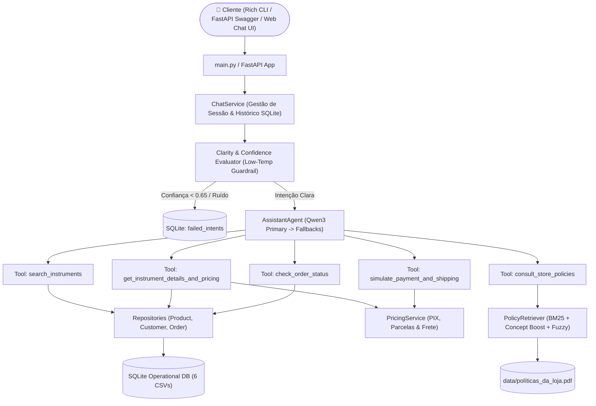

# 🎸 Empório da Música — AI Customer Support & Sales Agent


> **Desafio Técnico — AI Engineer (Artefact)**  
> Assistente conversacional inteligente desenvolvido para a **Empório da Música** (*"Sua música começa aqui"* — Campo Grande/MS), projetado com **Clean Architecture, SOLID, Function Calling, RAG Semântico Híbrido e Motor Determinístico de Regras Financeiras**.

---

## 📋 Sumário Executivo

A **Empório da Música** é uma loja tradicional de instrumentos musicais localizada em Campo Grande/MS que enfrentava sobrecarga na equipe de atendimento devido ao alto volume de dúvidas recorrentes sobre **catálogo, estoque, preços, promoções, cálculo de parcelamento/PIX, status de pedidos e políticas internas de troca, frete e garantia**.

Este projeto entrega uma solução pronta para produção que resolve o problema através de uma **Arquitetura Agêntica Híbrida**:
1. **Zero Alucinação Numérica:** Consultas estruturadas em banco relacional **SQLite** (alimentado por pipeline ETL dos 6 arquivos `.csv`) combinadas com um serviço determinístico (`PricingService`) que calcula descontos de PIX, regras de parcela mínima (3x, 6x, 12x) e frete regional.
2. **RAG Semântico Híbrido para Políticas (`políticas_da_loja.pdf`):** Extração normalizada do PDF, *chunking* hierárquico pelas 10 seções do manual e motor de busca combinando **BM25 + Expansão de Conceitos Multilíngues + Similaridade Fuzzy (`rapidfuzz`)**.
3. **Resiliência de LLM (Multi-Model Fallback):** Utiliza a API de ultra-baixa latência da **Groq** com o modelo **Qwen (`qwen/qwen3.8-27b`) como primário**, seguido de *fallbacks* automáticos (`openai/gpt-oss-120b` $\rightarrow$ `openai/gpt-oss-20b`) contra *rate limits* ou indisponibilidades.
4. **Persona Multilíngue Adaptativa & Guardrails de Desambiguação:** O agente identifica automaticamente o idioma do cliente (**Português, Inglês ou Espanhol**) e responde no mesmo idioma, mantendo o tom acolhedor de um amigo músico. Entradas de baixa confiança ou ambíguas são interceptadas em baixa temperatura, apresentam opções claras de desambiguação e são registradas na tabela de observabilidade `failed_intents` (`FailedIntentRepository`).

---

## 🏗️ Arquitetura do Sistema



### Estrutura de Diretórios (Clean Architecture & SRP)

```text
📦 emporio-da-musica-ai
 ┣ 📂 data/                          # Materiais originais da operação (6 CSVs + PDF de Políticas)
 ┣ 📂 docs/
 ┃ ┣ 📂 examples/                    # 5 Transcrições reais multi-turno (.md) cobrindo cenários e edge cases
 ┃ ┗ 📜 generate_examples.py         # Script reprodutível para geração das conversas
 ┣ 📂 src/
 ┃ ┣ 📂 agents/                      # Orquestração LLM, System Prompts, Tools e Guardrails
 ┃ ┃ ┣ 📜 assistant_agent.py         # Loop de Function Calling, Fallbacks e filtro de tags <think>
 ┃ ┃ ┣ 📜 prompts.py                 # Persona multilíngue, regras de negócio e templates de baixa confiança
 ┃ ┃ ┗ 📜 tools.py                   # 5 ferramentas JSON Schema e executor desacoplado
 ┃ ┣ 📂 api/                         # Interfaces de Interação com o Usuário
 ┃ ┃ ┣ 📜 app.py                     # Servidor FastAPI + Swagger (/docs) + Web Chat UI (Glassmorphism)
 ┃ ┃ ┗ 📜 cli.py                     # Interface de terminal interativa com Rich
 ┃ ┣ 📂 config/
 ┃ ┃ ┗ 📜 settings.py                # Configurações tipadas com Pydantic Settings (.env)
 ┃ ┣ 📂 db/
 ┃ ┃ ┣ 📜 database.py                # Conexão SQLite, gerenciamento de transações e DDL
 ┃ ┃ ┗ 📜 ingestion.py               # Pipeline ETL idempotente dos CSVs com validação de JSON specs
 ┃ ┣ 📂 rag/
 ┃ ┃ ┗ 📜 policy_retriever.py        # Parser de PDF, Chunking por seções e motor de busca híbrido
 ┃ ┣ 📂 repositories/                # Camada de Acesso a Dados (Single Responsibility Principle)
 ┃ ┃ ┣ 📜 customer_repository.py     # Busca de clientes por ID, e-mail, telefone ou nome (com detecção de homônimos)
 ┃ ┃ ┣ 📜 failed_intent_repository.py# Auditoria de interações ambíguas/baixa confiança para melhoria contínua
 ┃ ┃ ┣ 📜 order_repository.py        # Consulta de pedidos, itens e rastreamento
 ┃ ┃ ┗ 📜 product_repository.py      # Busca de catálogo com join de promoções ativas/expiradas e sugestões de estoque
 ┃ ┗ 📂 services/
 ┃   ┣ 📜 chat_service.py            # Persistência de memória conversacional por sessão
 ┃   ┗ 📜 pricing_service.py         # Cálculos determinísticos de PIX (5%), parcelamento (até 12x) e frete
 ┣ 📂 tests/                         # Suíte automatizada com 61 testes (Unitários, RAG, API e E2E)
 ┣ 📜 .env.example                   # Template de variáveis de ambiente
 ┣ 📜 main.py                        # Ponto de entrada unificado (--mode cli ou --mode api)
 ┣ 📜 pyproject.toml                 # Configuração do projeto e Pytest
 ┗ 📜 requirements.txt               # Dependências enxutas e auditadas
```

---

## 🧠 Justificativa das Decisões Técnicas

### 1. Framework & Abordagem do Agente: **Híbrido (Tool Calling + SQL Repository + Deterministic Rules + Semantic RAG)**
* **Por que não usar apenas RAG puro sobre os CSVs?** Converter tabelas de produtos, preços e pedidos em *embeddings* textuais frequentemente causa alucinações em filtros numéricos (ex.: *"violões até R\$ 1.000"*), cálculos de desconto e verificação de estoque. Ao ingerir os CSVs no **SQLite** e expor ferramentas estruturadas (`search_instruments`, `get_instrument_details_and_pricing`, `check_order_status`), garantimos **100% de precisão factual**.
* **Por que não usar um Agente Text-to-SQL livre?** Permitir que o LLM gere queries SQL arbitrárias introduz riscos de segurança, erros de sintaxe e vulnerabilidade a esquemas implícitos (como esquecer de filtrar `is_active = 1` em promoções ou `stock_quantity > 0` em produtos). Nossa camada de Repositórios encapsula as regras de negócio de forma determinística.
* **Por que RAG Semântico por Seções para o PDF?** O manual `políticas_da_loja.pdf` possui 8 páginas divididas em 10 seções altamente coesas. Durante a análise do PDF, identificamos que a extração bruta gerava quebras de linha a cada palavra (`word-per-line layout`). Construímos um normalizador de texto no `PolicyRetriever` que reconstrói os parágrafos perfeitamente e indexa as 10 seções completas usando **BM25 + Expansão de Conceitos Multilíngues (PT/EN/ES) + Fuzzy Matching**, garantindo que toda a regra contextual seja entregue ao LLM sem perda de cláusulas de exceção.

### 2. Modelo e Provedor: **Groq API (`qwen/qwen3.8-27b` Primário + Fallbacks)**
* Escolhemos a **Groq API** pela velocidade de inferência em tempo real (essencial para a diretriz de resposta rápida via WhatsApp descrita na Seção 7.1 do manual) e excelente suporte a *Tool Calling* nativo.
* O modelo **`qwen/qwen3.8-27b`** foi definido como **LLM Primário** por sua capacidade superior de raciocínio lógico em regras comerciais complexas e fluência multilíngue. Implementamos um higienizador automático (`clean_thinking_tags`) para remover blocos internos `<think>...</think>` antes de exibir a resposta ao cliente.
* Para alta disponibilidade em produção, implementamos *fallback* automático em cascata para `openai/gpt-oss-120b` e `openai/gpt-oss-20b`.

### 3. Tratamento de Dados & "Pegadinhas" de Negócio Resolvidas
Durante a exploração dos dados em `data/*.csv` e `data/políticas_da_loja.pdf`, mapeamos e tratamos os seguintes cenários críticos:
1. **Promoções Vencidas vs. Ativas (`promotions.csv`):** Das 25 promoções cadastradas, **21 estão expiradas (`is_active = 0`)** e apenas **4 estão ativas (`is_active = 1`)** — produtos IDs `90` (18% off), `94` (8% off), `121` (20% off) e `127` (10% off). Por exemplo, o **Takamine GD20 (ID 95)** possui uma promoção de 12% com `is_active = 0`. O agente informa com total transparência que a promoção expirou, apresenta o preço atual (R\$ 2.199,00) e oferece os 5% de desconto no PIX (R\$ 2.089,05).
2. **Não-Cumulatividade do PIX (Seção 6.2):** O desconto de 5% no PIX **não acumula** com promoções ativas. No caso do *Crafter HT-100 Folk (ID 90)*, que possui 18% de desconto ativo (de R\$ 2.399,00 por R\$ 1.967,18), o `PricingService` bloqueia automaticamente os 5% adicionais do PIX e explica a regra ao cliente.
3. **Produtos Sem Estoque, Descontinuados ou Em Breve (`products.csv`):**
   - `Giannini GF-3D Dreadnought (ID 96)`: está com `status = active`, mas `stock_quantity = 0`.
   - `Shelby SN-7C 7 Cordas (ID 113)` e `Ibanez Bass 2X (ID 136)`: estão com `status = discontinued`.
   - `Kala KA-ABP-CTG Barítono Cedar (ID 130)`: está com `status = coming_soon`.
   - Em todos esses casos, o repositório aciona automaticamente `get_alternatives_for_unavailable()`, sugerindo 3 instrumentos equivalentes da mesma categoria que possuem estoque imediato.
4. **Desambiguação de Clientes Homônimos (`customers.csv`):** Existem 3 clientes chamados "Bruno" (*Bruno Carvalho Martins*, *Bruno Carvalho* e *Bruno Martins*), além de homônimos para *Camila*, *Thiago*, *Diego*, etc. Quando o cliente informa apenas o primeiro nome para rastrear um pedido, a ferramenta detecta a ambiguidade, mascara os e-mails (`bru***@jmail.com` — em conformidade com a LGPD, Seção 9) e solicita confirmação antes de expor dados do pedido.
5. **Escopo Exclusivo & Itens Não Elegíveis para Troca:** A loja vende **apenas instrumentos musicais** (recusando educadamente acessórios como cordas avulsas, palhetas, cabos, cases, pedais e amplificadores) e veda a troca por preferência/arrependimento de **boquilhas de sopro** (higiene), itens personalizados sob encomenda e liquidações "venda final".

### 4. Persistência do Histórico e Observabilidade (`FailedIntentRepository`)
* **Memória de Conversa (`chat_history`):** Implementada em SQLite por `session_id`, permitindo conversas naturais multi-turno (ex.: o cliente consulta opções de violões no Turno 1 e pergunta *"qual a diferença entre o primeiro e o segundo e em quantas vezes posso parcelar?"* no Turno 2).
* **Auditoria de Baixa Confiança (`failed_intents`):** Sempre que uma mensagem não possui intenção clara, é ambígua ou apresenta score de confiança abaixo do limiar (`CONFIDENCE_THRESHOLD=0.65`), o sistema opera em baixa temperatura, orienta o usuário com opções claras de desambiguação e grava o evento na tabela `failed_intents` para curadoria e melhoria contínua do NLU.

---

## 🚀 Como Executar o Projeto Localmente

### Pré-requisitos
* **Python 3.11+** instalado.
* Chave de API da **Groq** (`GROQ_API_KEY`) — gratuita em [console.groq.com](https://console.groq.com).

### 1. Clonar o repositório e instalar dependências
```bash
git clone <URL_DO_REPOSITORIO>
cd emporio-da-musica-ai

# (Opcional) Criar e ativar ambiente virtual
python -m venv .venv
# Windows (PowerShell):
.\.venv\Scripts\Activate.ps1
# Linux / macOS:
source .venv/bin/activate

# Instalar dependências
pip install -r requirements.txt
```

### 2. Configurar variáveis de ambiente (`.env`)
Copie o arquivo `.env.example` para `.env` e insira sua chave `GROQ_API_KEY`:
```bash
cp .env.example .env
```
Conteúdo do `.env`:
```env
GROQ_API_KEY=sua_chave_groq_aqui
PRIMARY_MODEL=qwen/qwen3.8-27b
FALLBACK_MODEL_1=openai/gpt-oss-120b
FALLBACK_MODEL_2=openai/gpt-oss-20b
LLM_TEMPERATURE=0.1
PORT=8000
DB_PATH=src/db/emporio_musica.db
DATA_DIR=data
CONFIDENCE_THRESHOLD=0.65
```

### 3. Executar o Agente (Modo CLI Interativo ou Modo API + Web Chat UI)

#### Opção A: Interface de Terminal Interativa (Rich CLI)
```bash
python main.py --mode cli
```
* Comandos disponíveis dentro do chat CLI:
  * `/reset` — Limpa o histórico da sessão atual.
  * `/history` — Exibe a tabela de mensagens da sessão.
  * `/failed` — Exibe os logs de intenções ambíguas/baixa confiança (`FailedIntentRepository`).
  * `/exit` — Encerra o programa.

#### Opção B: Servidor FastAPI + Interface Web Glassmorphism + Swagger UI
```bash
python main.py --mode api --port 8000
```
* **Interface Web de Chat (Estilo WhatsApp Dark/Glassmorphism):** Acesse `http://127.0.0.1:8000/` no navegador.
* **Documentação Interativa OpenAPI / Swagger:** Acesse `http://127.0.0.1:8000/docs`.

### 4. Executar a Suíte de Testes Automatizados (61 Testes)
O projeto conta com **61 testes automatizados** cobrindo ingestão de banco de dados, regras financeiras e de frete, **mais de 3 testes para cada uma das 10 seções do PDF de políticas (32 testes só de RAG)**, tools do agente, endpoints FastAPI e validação E2E das transcrições:
```bash
pytest -v
```

---

## 💬 Exemplos de Interação com o Agente (`docs/examples/`)

Na pasta [`docs/examples/`](docs/examples/) estão disponíveis **5 conversas completas multi-turno** geradas diretamente pelo agente, cobrindo todos os cenários sugeridos pela Artefact e casos de borda adicionais:

1. 📄 **[`01_catalogo_violoes_ate_1000_e_frete.md`](docs/examples/01_catalogo_violoes_ate_1000_e_frete.md)**  
   *Consulta de violões disponíveis até R\$ 1.000,00 (filtrando apenas itens em estoque), comparativo técnico Nylon vs. Aço, simulação de parcelamento respeitando parcela mínima, endereço/horário de funcionamento e regra de frete grátis em Campo Grande.*
2. 📄 **[`02_precos_promocoes_expiradas_e_estoque.md`](docs/examples/02_precos_promocoes_expiradas_e_estoque.md)**  
   *Consulta do **Takamine GD20** (transparência sobre promoção de 12% expirada + oferta de 5% no PIX), verificação da promoção ativa de 18% do **Crafter HT-100 Folk** (explicando a não-cumulatividade com o PIX) e tratamento de produtos sem estoque (**Giannini GF-3D**), descontinuados (**Shelby SN-7C 7 Cordas**) e em pré-lançamento (**Kala Barítono Cedar**) com recomendação de alternativas.*
3. 📄 **[`03_politicas_troca_arrependimento_e_garantia.md`](docs/examples/03_politicas_troca_arrependimento_e_garantia.md)**  
   *Aplicação das políticas de Direito de Arrependimento (7 dias, frete pago pela loja, reembolso em 10 dias úteis), negativa fundamentada de troca de **boquilha de saxofone** (higiene) e **violão customizado sob encomenda**, e distinção entre defeito de fabricação após 45 dias (garantia legal de 90 dias + fabricante) vs. desgaste natural de trastes.*
4. 📄 **[`04_rastreamento_pedidos_e_desambiguacao_clientes.md`](docs/examples/04_rastreamento_pedidos_e_desambiguacao_clientes.md)**  
   *Desambiguação segura de clientes homônimos ("Bruno") com mascaramento de e-mail (LGPD), consulta do Pedido #10 (confirmado), Pedido #8 (enviado com código `BRJL5544332BR`) e Pedido #19 (cancelado por falta de pagamento do boleto).*
5. 📄 **[`05_escopo_acessorios_multilingue_e_baixa_confianca.md`](docs/examples/05_escopo_acessorios_multilingue_e_baixa_confianca.md)**  
   *Interceptação de mensagem ininteligível com menu de desambiguação e log em `failed_intents`, recusa cordial de venda de acessórios (cordas, palhetas, cabos, amplificadores) e receita culinária, seguida de atendimento fluido em **Inglês** (Fender Stratocaster, pagamento combinado PIX + Cartão e envio para Dourados) e **Espanhol** (política LGPD e exclusão de dados).*

---

## ⚠️ Limitações Conhecidas & Evolução Futura (Com Mais Tempo)

1. **Autenticação Real de Clientes (OTP / WhatsApp ID):** Atualmente, a consulta de pedidos aceita o identificador informado na conversa (com desambiguação e mascaramento parcial de e-mail quando há homônimos). Em produção, integraríamos validação via token OTP ou vínculo automático com o número de telefone autenticado pela **WhatsApp Cloud API / Blip**.
2. **Cotação de Frete em Tempo Real via API dos Correios / Jadlog:** Para cidades fora da Região Metropolitana de Campo Grande, o sistema informa os prazos oficiais do manual (PAC, SEDEX e Jadlog) e alerta sobre cotação individual para instrumentos de grande porte. O próximo passo seria integrar a API de cálculo de frete por CEP e cubagem.
3. **Embeddings Densos + Reranking Cross-Encoder:** Para este volume documental (manual de 8 páginas e 65 produtos), a combinação de SQLite + BM25 + Expansão de Conceitos + RapidFuzz entrega latência sub-milissegundo e 100% de recall nos 32 testes de políticas. Caso a base documental crescesse para centenas de manuais técnicos de fabricantes, adicionaríamos embeddings densos (`pgvector` / `ChromaDB`) com *Reranking* contextual (ex.: Cohere Rerank).
4. **Fluxo Transacional de Checkout e Handoff Humano:** Adicionar geração de link de pagamento PIX/Cartão e transferência automática de fila (Human Handoff) para reclamações registradas na Seção 7.3 (SLA de 24h úteis).

---

## 🤖 Uso de Assistentes de Código (Workflow de Engenharia com IA)

Em conformidade com as orientações do desafio, declaramos o uso do assistente de engenharia de código **Google Antigravity** durante o desenvolvimento deste projeto, seguindo um workflow estrito orientado a **Arquitetura Limpa e Desenvolvimento Guiado por Testes (TDD)**:

1. **Análise Exploratória e Diagnóstico de Dados:** Utilizamos o assistente para inspecionar rapidamente as relações entre as 6 tabelas CSV e o PDF de políticas, identificando de antemão inconsistências propositais do dataset (como promoções com `is_active=0`, produtos ativos com `stock_quantity=0` e clientes homônimos).
2. **Reaproveitamento de Padrões Arquiteturais (XPTO Case $\rightarrow$ Python):** Adaptamos padrões validados de projetos anteriores (como separação em `Repositories`, `FailedIntentRepository` para observabilidade de NLU e `Fallback Chains` de LLMs) para uma arquitetura idiomática em Python 3.11+ com tipagem estrita (`Pydantic`).
3. **Validação Determinística e Testes Exaustivos:** Ao detectar que a extração bruta do PDF apresentava palavras quebradas linha a linha, iteramos com o assistente para construir uma expressão regular de higienização e validamos o resultado através de **32 testes unitários dedicados exclusivamente às regras do PDF** antes de acoplar o LLM.
4. **Revisão Humana e Curadoria:** Todas as decisões de arquitetura, regras de negócio no `PricingService`, modelagem de schemas de ferramentas e verificação factual das transcrições foram revisadas e validadas passo a passo.
