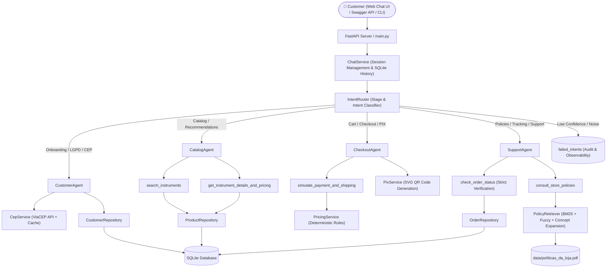

# 🎸 Empório da Música — AI Customer Support & Sales Agent

**🌐 Languages:** [🇺🇸 English Version](README_EN.md) | [🇧🇷 Versão em Português](README.md)


> **Conversational E-commerce AI Assistant & Specialized Multi-Agent Architecture**  
> Developed for **Empório da Música** (*"Sua música começa aqui"* — Campo Grande/MS, Brazil), grounded in **Clean Architecture, SOLID, Native Function Calling, Hybrid Semantic RAG, Deterministic Business Engine, and a Modern Glassmorphism Web Interface**.

---

## ⚡ Technical Evaluator Quick Start (3-Minute Setup)

If you are evaluating this project and wish to test the system immediately, follow these steps:

### 1. Clone, Install, and Start Server

```bash
# 1. Clone repository and navigate to folder
git clone https://github.com/claudio-cardoso-dev/emporio-da-musica-ai.git
cd emporio-da-musica-ai

# 2. Create and activate virtual environment
python -m venv .venv
# Windows (PowerShell):
.\.venv\Scripts\Activate.ps1
# Linux / macOS:
source .venv/bin/activate

# 3. Install dependencies
pip install -r requirements.txt

# 4. Set up environment variables (.env)
cp .env.example .env
# Ensure GROQ_API_KEY=gsk_... is configured in .env (free key at console.groq.com)
# Note: The system includes a robust deterministic fallback that operates even without LLM connectivity.

# 5. Launch the application in API Mode (with Glassmorphism Web Chat)
python main.py --mode api --port 8000
```

Open in your browser: **[`http://localhost:8000`](http://localhost:8000)**  
(Interactive Swagger API documentation available at **[`http://localhost:8000/docs`](http://localhost:8000/docs)**)

---

### 2. Interactive Test Script (Ready-to-Use Prompts)

To validate all technical criteria end-to-end in the Web UI, you can copy and paste the following prompts:

| Step / Feature | What to enter in chat | Expected System Action / Validation |
| :--- | :--- | :--- |
| **1. Secure Identification (LGPD)** | `(67) 99812-3456` | Identifies customer **Lucas Mendes da Silva**, greets warmly, and offers quick action buttons. |
| **2. Catalog Query with Filter** | `quero ver violões até 1000 reais` | Dispatches `CatalogAgent`, queries SQLite, and renders 3D product cards with "Add to Cart" buttons. |
| **3. Broad Search (No Truncation)** | `quero ver produtos até 2000 reais` | Returns **all 37 instruments** priced up to R$ 2,000.00 (from R$ 159.90 to R$ 1,967.18) with zero premature pagination truncation. |
| **4. Unavailable Item Handling** | `tem pandeiro?` | Cordially clarifies that the store specializes in string, keyboard, wind, and drum percussion instruments, **without hallucinating stock or polluting the screen**. |
| **5. 3D Card & Sound Sample** | *Click on 🎧 Amostra Sonora or 📖 Descrição* | The card rotates 3D, revealing an audio synthesizer sample of the instrument and full specs modal. |
| **6. Cart & Checkout Transition** | `adicionar 1 Giannini GF-1R ao carrinho` then `fechar meu pedido` | Transitions to `CheckoutAgent`. Displays cart summary and requests registered address confirmation. |
| **7. Address Confirmation & Shipping** | `Sim, endereço correto` | Validates address and computes deterministic shipping (Free for Campo Grande orders >= R$ 300; flat rate otherwise). |
| **8. Payment Simulation (PIX)** | `⚡ Pagar no PIX (5% off)` *(or "no pix")* | Applies 5% cash discount, generates PIX payload and renders **dynamic SVG QR Code**, presenting final order review. |
| **9. Order Confirmation** | `Sim, confirmar pedido` | Successfully registers order, confirms store motoboy dispatch, and **triggers post-purchase CSAT survey (1 to 5)**. |
| **10. CSAT Survey** | `⭐ 5 (Excelente)` *(or enter "5")* | Records rating, provides a courteous closing message, and cleanly ends the session with `[ 🔄 Novo Atendimento ]`. |
| **11. Regret Policy & Returns** | `Me arrependi da minha compra, posso devolver meu pedido?` | Dispatches `SupportAgent`. Prioritizes **Section 4.1 / Consumer Code (CDC)**: 7-day remorse window, 100% free return shipping, 10-day refund, identifying delivered Order #4. |
| **12. Deterministic Tracking** | `quero ver meus pedidos` | Queries SQLite relational database and displays Order #4 details with tracking code `BRQM7890123BR`, estimated delivery, and status. |
| **13. Human Attendant Request** | `quero falar com atendente` | Smoothly routes user to the store's official WhatsApp (`(67) 3321-4500` / `https://wa.me/556733214500`). |

---

## 📋 Executive Summary

**Empório da Música** is a traditional musical instruments store founded in 2008 in Campo Grande/MS (Brazil), seeking to scale customer operations while preserving musical expertise, customer proximity, and strict data security.

This project delivers a production-ready solution based on a **Hybrid Specialist Multi-Agent Architecture**:

1. **Specialist Multi-Agent Routing (`IntentRouter`):**  
   Dynamic and deterministic routing directing each turn to dedicated agents with restricted tool access and specialized prompts:
   - **`CustomerAgent`:** Privacy-compliant onboarding (LGPD), phone/email identification, and **ViaCEP** integration for live address validation.
   - **`CatalogAgent`:** Zero-hallucination instrument discovery, stock/price filters, and interactive 3D card rendering.
   - **`CheckoutAgent`:** Cart closure, deterministic installment validation (strictly enforcing maximum 12x and tier minimums: R$ 50 up to 3x, R$ 80 for 4-6x, R$ 100 for 7-12x), 5% PIX discount, intermediate order review, and secure simulation.
   - **`SupportAgent`:** Exchange and return policies (CDC), order tracking status with ownership validation, and institutional assistance.
2. **Zero Numerical Hallucination & Strict Business Rules:**  
   Structured **SQLite** queries coupled to pure Python `PricingService` logic to guarantee mathematical precision (blocking double PIX discount on promotional items, preventing unauthorized installments, and computing shipping).
3. **Hybrid Semantic RAG for Store Policies (`políticas_da_loja.pdf`):**  
   Hierarchical PDF parsing with layout normalization and search engine combining **BM25 + Multilingual Concept Expansion (PT/EN/ES) + Fuzzy Matching (`rapidfuzz`)**.
4. **LLM Resilience (Multi-Model Fallback Chain):**  
   Ultra-low latency inference via **Groq API** with **Qwen (`qwen/qwen3.8-27b`) as primary**, featuring automatic cascading fallbacks (`openai/gpt-oss-120b` $\rightarrow$ `openai/gpt-oss-20b`) against network drops or rate limits.
5. **High-Standard Conversational UI (Glassmorphism Web UI):**  
   - Interactive 3D flip cards with front/back specs.
   - Synthesized audio timbre preview.
   - Direct inline quantity adjustments and add-to-cart controls.
   - Two-step checkout with order review and post-checkout CSAT survey.

---

## 🏗️ System Architecture



---

### 📂 Directory Structure (Clean Architecture & Modularity)

```text
📦 emporio-da-musica-ai
 ┣ 📂 data/                          # Operational data (6 original CSVs + Policies PDF)
 ┣ 📂 docs/
 ┃ ┣ 📂 examples/                    # 5 Multi-turn real transcripts (.md)
 ┃ ┗ 📜 generate_examples.py         # Script generating test scenarios
 ┣ 📂 src/
 ┃ ┣ 📂 agents/                      # Orchestration & Specialist Agents
 ┃ ┃ ┣ 📜 assistant_agent.py         # Central orchestrator & session state manager
 ┃ ┃ ┣ 📜 router.py                  # IntentRouter for classification & state transitions
 ┃ ┃ ┣ 📜 specialists.py             # Dedicated agents: Catalog, Checkout, Customer, Support
 ┃ ┃ ┣ 📜 prompts.py                 # Persona, safety guidelines, and business rules
 ┃ ┃ ┗ 📜 tools.py                   # Typed Function Calling tool schemas
 ┃ ┣ 📂 api/                         # Presentation Layer
 ┃ ┃ ┣ 📜 app.py                     # FastAPI API + Swagger (/docs) + Glassmorphism Web UI
 ┃ ┃ ┗ 📜 cli.py                     # Interactive terminal using Rich
 ┃ ┣ 📂 config/
 ┃ ┃ ┗ 📜 settings.py                # Typed settings via Pydantic Settings (.env)
 ┃ ┣ 📂 db/
 ┃ ┃ ┣ 📜 database.py                # SQLite connection, DDL, and context managers
 ┃ ┃ ┗ 📜 ingestion.py               # Idempotent ETL pipeline with data validation
 ┃ ┣ 📂 rag/
 ┃ ┃ ┗ 📜 policy_retriever.py        # Hierarchical PDF parser + BM25 & Fuzzy search engine
 ┃ ┣ 📂 repositories/                # Data Access Layer (Repository Pattern)
 ┃ ┃ ┣ 📜 customer_repository.py     # Customer management, homonyms, and address updates
 ┃ ┃ ┣ 📜 failed_intent_repository.py# Observability and audit of ambiguous queries
 ┃ ┃ ┣ 📜 order_repository.py        # Orders query, items, and delivery history
 ┃ ┃ ┗ 📜 product_repository.py      # Instrument catalog joining active/expired promotions
 ┃ ┗ 📂 services/
 ┃   ┣ 📜 cep_service.py             # Resilient ViaCEP integration + offline cache
 ┃   ┣ 📜 chat_service.py            # Session persistence & message history
 ┃   ┣ 📜 pix_service.py             # Dynamic PIX payload and in-memory SVG QR Code
 ┃   ┗ 📜 pricing_service.py         # PIX discounts (5%), installments, and shipping rules
 ┣ 📂 tests/                         # Automated test suite with 111 tests
 ┣ 📜 .env.example                   # Environment configuration template
 ┣ 📜 main.py                        # Unified entry point (--mode cli or --mode api)
 ┣ 📜 pyproject.toml                 # Build and test configurations
 ┗ 📜 requirements.txt               # Audited dependencies
```

---

## 🎯 Technical Case Requirements & Implementation

| Case Requirement | Implementation in Project | Technical Validation / Evidence |
| :--- | :--- | :--- |
| **1. Specialized Multi-Agent Architecture** | `IntentRouter` dynamically maps turns to `CustomerAgent`, `CatalogAgent`, `CheckoutAgent`, and `SupportAgent`. | Tools strictly restricted per agent (`allowed_tool_names`), preventing scope leakage. |
| **2. Data Ingestion & Relational Integrity** | Idempotent ETL pipeline (`src/db/ingestion.py`) populating SQLite from the 6 official CSVs. | 50 original seed customers maintained intact. Tests in `tests/test_ingestion_and_db.py`. |
| **3. Store Policies RAG** | Structured parser of `data/políticas_da_loja.pdf` with BM25 + Fuzzy + Multilingual concept expansion. | 26 automated tests covering all 10 manual sections (`tests/test_rag_policies.py`). |
| **4. Deterministic Business Engine** | `PricingService` calculates installments, 5% PIX discount, and non-cumulativity with active promos. | Pure mathematical resolution without delegating financial logic to probabilistic models. |
| **5. Local and Regional Shipping Rules** | Free shipping for Campo Grande/MS orders >= R$ 300 via store motoboy; flat R$ 25/35 fee otherwise; regional carriers with insurance. | Section 5 policies strictly enforced and tested across scenarios. |
| **6. Exchange & Regret Policies** | `SupportAgent` prioritizes return and regret queries (Section 4.1 / Art. 49 CDC): 7 days, 100% free return shipping, 10-day refund. | Prioritized over order tracking. Tested in `test_support_return_and_regret_policy_not_intercepted_by_order_tracking`. |
| **7. CSAT Survey (1 to 5 Stars)** | Post-checkout automated survey with 1 to 5 star buttons (`⭐ 1` to `⭐ 5`), followed by courteous closure. | Clean state transition to `SATISFACTION_SURVEY` and `CLOSE_CHAT` action. |
| **8. High-Standard Conversational UI** | Responsive glassmorphism web chat with 3D flip cards, sound sample preview, and live CEP autocompletion. | Instant rendering without sluggishness or frontend jargon. |
| **9. Observability & Auditing** | `failed_intents` table records low-confidence (`< 0.65`) or noisy messages for continuous improvement. | Endpoint `/api/intents/failed` and CLI command `/failed` available for inspection. |

---

## 🚀 How to Run Locally

### Prerequisites
* **Python 3.11+** installed.
* **Groq** API Key (`GROQ_API_KEY`) — free at [console.groq.com](https://console.groq.com).

### 1. Clone repository and install dependencies
```bash
git clone https://github.com/claudio-cardoso-dev/emporio-da-musica-ai.git
cd emporio-da-musica-ai

# Create and activate virtual environment
python -m venv .venv

# On Windows (PowerShell):
.\.venv\Scripts\Activate.ps1
# On Linux/macOS:
source .venv/bin/activate

# Install dependencies
pip install -r requirements.txt
```

### 2. Configure environment variables (`.env`)
```bash
cp .env.example .env
```
Edit `.env` with your settings:
```env
GROQ_API_KEY=gsk_your_groq_key_here
PRIMARY_MODEL=qwen/qwen3.8-27b
FALLBACK_MODEL_1=openai/gpt-oss-120b
FALLBACK_MODEL_2=openai/gpt-oss-20b
LLM_TEMPERATURE=0.1
PORT=8000
DB_PATH=src/db/emporio_musica.db
DATA_DIR=data
CONFIDENCE_THRESHOLD=0.65
```

### 3. Run the Application

#### API Mode with Glassmorphism Web Interface (Recommended)
```bash
python main.py --mode api --port 8000
```
- **Web Chat UI:** Open [`http://localhost:8000`](http://localhost:8000) in your browser.
- **Interactive Swagger Docs:** Access [`http://localhost:8000/docs`](http://localhost:8000/docs).
- **Healthcheck:** Access [`http://localhost:8000/health`](http://localhost:8000/health).

#### Terminal Mode (Rich CLI)
```bash
python main.py --mode cli
```
- Interactive CLI commands:
  - `/reset` — Resets conversation session.
  - `/history` — Formats and displays message history.
  - `/failed` — Inspects low-confidence audit logs.
  - `/exit` — Exits CLI.

---

## 🧪 Automated Test Suite (111 Tests)

The test suite ensures 100% reliability across all layers:
- Database ingestion and referential integrity (`tests/test_ingestion_and_db.py`).
- Financial rules and installment bounds (`tests/test_pricing_and_rules.py`).
- Exhaustive coverage of all 10 policy sections (`tests/test_rag_policies.py`).
- Multi-agent routing and state transitions (`tests/test_multi_agent.py`).
- Vocabulary sanitization and jargon prevention (`tests/test_agent_tools.py`).
- FastAPI endpoints, ViaCEP queries, and SVG QR Code generation (`tests/test_api_interface.py`).
- End-to-end full customer journey tests (`tests/test_e2e_scenarios.py`).

To run the full test suite:
```bash
python -m pytest -v
```

Execution output:
```text
====================== 111 passed, 3 warnings in 28.29s =======================
```

---

## 💬 Example Transcripts (`docs/examples/`)

The repository includes 5 multi-turn conversation transcripts covering key scenarios and edge cases:

1. 📄 **[`01_catalogo_violoes_ate_1000_e_frete.md`](docs/examples/01_catalogo_violoes_ate_1000_e_frete.md)** — Price filtering, Nylon vs. Steel technical comparison, installment simulation, and free shipping policy in Campo Grande.
2. 📄 **[`02_precos_promocoes_expiradas_e_estoque.md`](docs/examples/02_precos_promocoes_expiradas_e_estoque.md)** — Transparency on expired discounts (Takamine GD20), PIX non-cumulativity, and out-of-stock alternatives.
3. 📄 **[`03_politicas_troca_arrependimento_e_garantia.md`](docs/examples/03_politicas_troca_arrependimento_e_garantia.md)** — 7-day remorse policy, hygiene restrictions (mouthpieces), and natural wear vs. legal warranty.
4. 📄 **[`04_rastreamento_pedidos_e_desambiguacao_clientes.md`](docs/examples/04_rastreamento_pedidos_e_desambiguacao_clientes.md)** — Customer disambiguation, LGPD data protection, and real-time shipment status tracking.
5. 📄 **[`05_escopo_acessorios_multilingue_e_baixa_confianca.md`](docs/examples/05_escopo_acessorios_multilingue_e_baixa_confianca.md)** — Noise interception logged to `failed_intents`, polite accessory scope boundary, and native English/Spanish support.

---

## 🛠️ Technologies & Libraries

- **Language & Runtime:** Python 3.11+
- **Web Framework & API:** FastAPI, Uvicorn, Pydantic v2
- **AI Provider & Models:** Groq API (`qwen/qwen3.8-27b`, `openai/gpt-oss-120b`, `openai/gpt-oss-20b`)
- **Data Access & RAG:** SQLite 3, BM25 (`rank-bm25`), RapidFuzz, pypdf
- **Frontend & Terminal:** Vanilla JS (Glassmorphism UI, CSS 3D Transforms, Web Audio API, SVG), Rich CLI
- **Quality & Testing:** Pytest, AnyIO, Starlette TestClient
